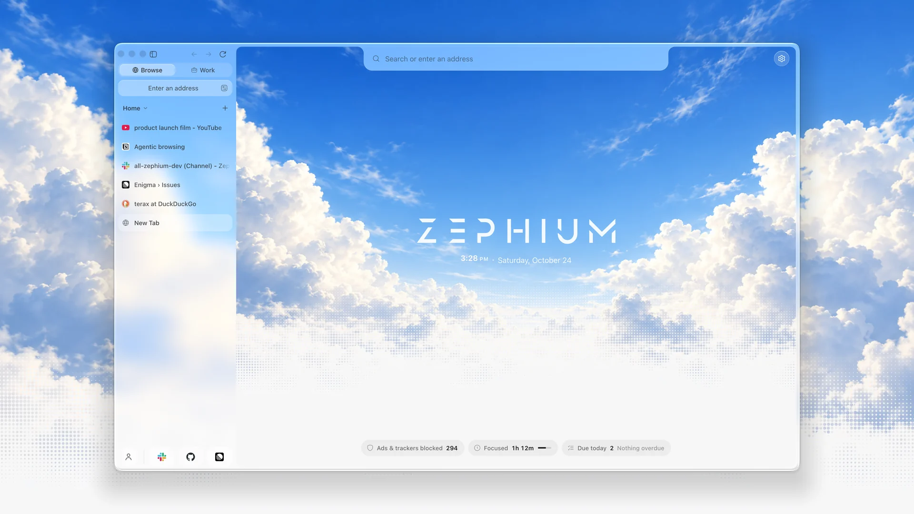
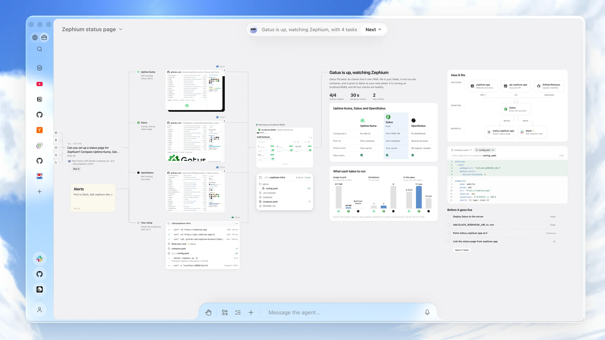
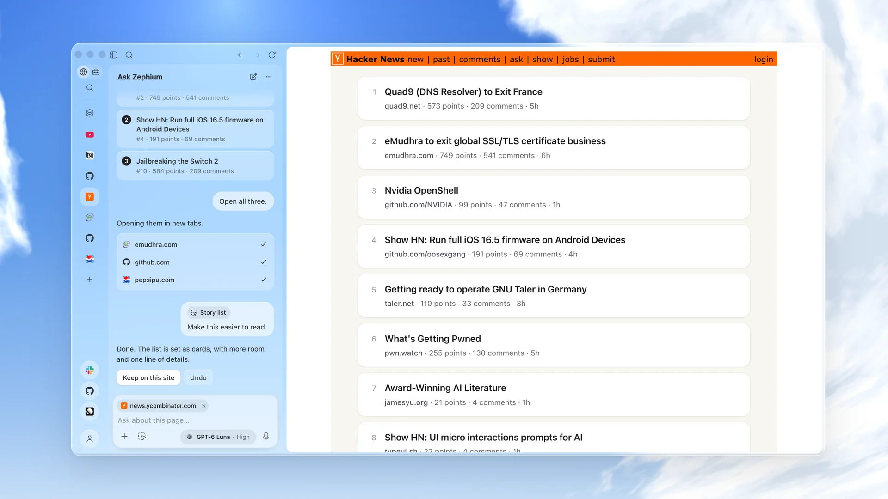
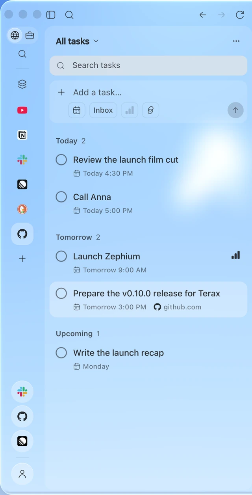
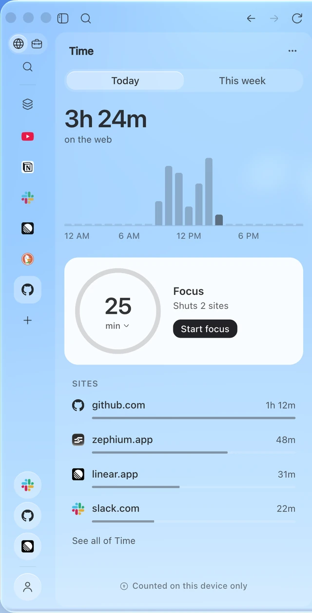
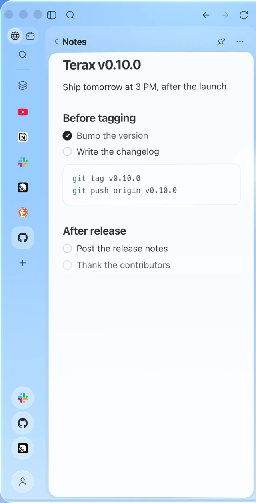

<div align="center">
  
  <h1>Zephium</h1>

  <p><strong>Szybka, w pełni funkcjonalna przeglądarka i środowisko pracy,<br />wymyślone na nowo dla Ciebie i Twoich agentów.</strong></p>

  <p>
    <a href="https://github.com/zephium-browser/Zephium/releases"></a>
    <a href="../../LICENSE"></a>
    
    <a href="https://discord.gg/tyveTUyEp7"></a>
    <a href="https://www.youtube.com/@crynta"></a>
    <a href="https://x.com/CryntaDev"></a>
  </p>

  <p>
    <a href="https://zephium.app">Strona WWW</a> ·
    <a href="https://zephium.app/docs">Dokumentacja</a> ·
    <a href="https://youtu.be/QbSarcWspvw">Film premierowy</a> ·
    <a href="https://github.com/zephium-browser/Zephium/releases/latest">Pobierz</a>
  </p>
</div>

<details align="center">
  <summary><sub>Przeczytaj w innym języku</sub></summary>
  <sub>
    <a href="../../README.md">English</a> ·
    <a href="README.zh-CN.md">简体中文</a> ·
    <a href="README.ja.md">日本語</a> ·
    <a href="README.ko.md">한국어</a> ·
    <a href="README.hi.md">हिन्दी</a> ·
    <a href="README.es.md">Español</a> ·
    <a href="README.pt-BR.md">Português</a> ·
    <a href="README.fr.md">Français</a> ·
    <a href="README.de.md">Deutsch</a> ·
    <a href="README.ru.md">Русский</a> ·
    <a href="README.id.md">Bahasa Indonesia</a>
  </sub>
</details>

<p align="center">
  <picture>
    <source media="(prefers-color-scheme: dark)" srcset="../../.github/assets/browse-dark.webp" />
    
  </picture>
</p>

<p align="center">
  <strong>Wydajność Safari. Ochrona Brave. Wygląd Arc.</strong><br />
  Do tego <strong>Work</strong>, kanwa, na której Twoi agenci wykonują prawdziwą pracę na Twoich oczach.
</p>

<p align="center"><a href="https://youtu.be/QbSarcWspvw">▶&nbsp; Obejrzyj film premierowy</a></p>

---

Zephium to otwartoźródłowa przeglądarka napisana w Rust, działająca na
silniku internetowym samego systemu operacyjnego: WebKit na macOS, czyli
silniku, którego używa Safari, oraz WebView2 w Windows. Nie jest forkiem
Chromium ani Firefoksa. Blokuje reklamy i trackery natywnie, uruchamia
rozszerzenia Chrome, a zadania, notatki i Twój czas w sieci są na wyciągnięcie
jednego kliknięcia. Pobieranie waży około 30 MB.

Jeden przełącznik dalej jest **Work**. Twoja praca i tak dzieje się w
przeglądarce, gdzie masz karty, logowania i historię. Work sprowadza tam
agentów, zamiast kazać Ci przenosić się gdzie indziej, i pozwala patrzeć, jak
pracują.

## Work

Opisz własnymi słowami, co chcesz osiągnąć: zaplanować podróż, porównać
dostawców, zaprojektować system, naprawić błąd. Dalej zajmuje się tym Work, na
kanwie, a Ty widzisz każdy krok.

<p align="center">
  
</p>
<p align="center"><sub>Poproszony o stronę statusu, Work czyta trzy monitory na ich własnych stronach, sprawdza Twoje endpointy z Twojego komputera, składa wybrane rozwiązanie i zostawia na kanwie porównanie, konfigurację i zadania.</sub></p>

- **Zaczyna od tego, co już masz.** Work przypomina sobie, co o Tobie wie,
  w razie potrzeby przeszukuje Twoją historię i ładuje odpowiednią umiejętność
  do zadania. Każdy krok pojawia się na kanwie na bieżąco.
- **Pomocnicy pracują równolegle i na widoku.** Przy planowaniu podróży jeden
  pomocnik szuka mieszkań, drugi sprawdza wizy, a trzeci porównuje loty.
  Przeglądają strony na żywo, które możesz oglądać, a każde źródło otwiera się
  w panelu obok kanwy.
- **Wyniki zostają na kanwie.** Porównania, tabele, wykresy, diagramy, plany,
  kod i dokumenty są rozłożone tak, by dało się je czytać. Nie giną w
  przewijanym czacie.
- **Plan staje się Twoim dniem.** Jednym kliknięciem zamieniasz każdy krok planu
  w zadanie powiązane z danym Work. Wszystko, co warto zachować, możesz zapisać
  jako notatkę.
- **Sięga poza przeglądarkę.** Work czyta i edytuje foldery, do których dasz
  dostęp, uruchamia polecenia, a większe zadania programistyczne przekazuje do
  Claude Code lub Codex. Łączy się z serwerami MCP, takimi jak Linear, Notion,
  Sentry, Stripe i Figma, oraz z narzędziami wiersza poleceń, takimi jak `gh`.
- **Ostatnie słowo należy do Ciebie.** Wszystko, co coś publikuje, scala albo
  zmienia, czeka na Twoją zgodę.
- **Dowolny model.** Użyj własnych kluczy do Anthropic, OpenAI, Google Gemini,
  DeepSeek lub OpenRouter albo uruchom model lokalnie przez Ollama, LM Studio
  lub dowolny serwer zgodny z OpenAI. Klucze są przechowywane w systemowym
  pęku kluczy.
  Albo zaloguj się do Zephium AI i pomiń klucze: sam dobiera odpowiedni model
  do każdego kroku, a na start dostajesz darmowe kredyty
  ([cennik](https://zephium.app/pricing)).

Work ma w zestawie 25 umiejętności, między innymi planowanie podróży, badanie
tematu, porównywanie i wybór, planowanie dnia, naprawę błędu i cotygodniowy
raport. Możesz napisać własne.

## Ask Zephium

Asystent na pasku bocznym, pod `⌘ E` (`Ctrl E` w Windows). Czyta stronę, na
której jesteś, i odpowiada na jej temat, wskazuje to, co warto Twojego czasu, i
otwiera w nowych kartach to, co wybierzesz. Poproś go, żeby wykonał kilka kroków
na stronie albo zmienił wygląd serwisu, który odwiedzasz codziennie, a zrobi to
na miejscu. Gdy zadanie wykracza poza rozmowę, **Continue in Work** przenosi je
na kanwę razem ze stroną.

<p align="center">
  
</p>
<p align="center"><sub>Zapytany, co warto przeczytać, wybiera trzy artykuły, otwiera je i układa stronę główną na nowo w spokojne kafelki.</sub></p>

## Browse

### Szybko i lekko

- Natywny WebKit na macOS i WebView2 w Windows, więc strony działają na silniku,
  który system i tak na bieżąco aktualizuje.
- Nieaktywne karty zasypiają i budzą się, gdy do nich wracasz, dzięki czemu
  zużycie pamięci pozostaje niskie nawet przy wielu otwartych kartach.
- Natywny bloker reklam i trackerów, domyślnie włączony, oparty na
  [adblock-rust](https://github.com/brave/adblock-rust) od Brave z listami
  EasyList i EasyPrivacy. Żądania są zatrzymywane, zanim strona zdąży je
  wysłać, a cokolwiek jeszcze na stronie przeszkadza, możesz ukryć jednym
  kliknięciem.

### Stworzona do codziennego życia

- Nowa karta, która otwiera się na niebo, w dzień lub w nocy, zależnie od motywu,
  a u dołu pokazuje Twój czas, skupienie i zadania na dziś.
- Pionowe karty w spokojnym pasku bocznym, z przestrzeniami, profilami,
  przypiętymi kartami, folderami i widokiem podzielonym.
- Liquid Glass w macOS 26 i Mica w Windows 11.
- Launcher pod `⌘ ⇧ Space` (`Ctrl Shift Space` w Windows) daje dostęp do kart,
  historii, notatek i poleceń z dowolnego miejsca na pulpicie. Wszystko, co tam
  wpiszesz, może stać się zadaniem.
- Każdy skrót klawiszowy można zmienić.

### Rozszerzenia

Instaluj rozszerzenia prosto ze sklepu Chrome Web Store. Dwadzieścia popularnych
zostało sprawdzonych i dobrze działa w Zephium, a w menedżerze rozszerzeń
instalujesz je jednym kliknięciem, między innymi 1Password, Bitwarden,
Grammarly, DeepL, Dark Reader, Vimium, SponsorBlock, Raindrop.io, Notion Web
Clipper i Refined GitHub.

### Zabierz wszystko ze sobą

Kreator powitalny importuje dane z Chrome, Safari, Arc, Zen, Firefoksa, Brave i
Edge.

## Wbudowane

<table>
  <tr>
    <td width="33%" align="center"></td>
    <td width="33%" align="center"></td>
    <td width="33%" align="center"></td>
  </tr>
  <tr>
    <td valign="top"><strong>Tasks</strong><br /><sub>Zapisuj je tak, jak powiedziałbyś na głos, na przykład „zadzwonić do Ani jutro o 15". Listy, priorytety, terminy, podzadania, a strona, na której byłeś, pozostaje powiązana.</sub></td>
    <td valign="top"><strong>Time</strong><br /><sub>Zobacz, na co idzie Twój czas w sieci; jest liczony wyłącznie na tym urządzeniu. Włącz rundę Focus, a wybrane przez Ciebie strony pozostaną zablokowane do przerwy.</sub></td>
    <td valign="top"><strong>Notes</strong><br /><sub>Notatki obok strony, każda to plik Markdown, który należy do Ciebie. Zmiany z innych aplikacji pojawiają się w Zephium.</sub></td>
  </tr>
</table>

## Prywatność domyślnie

- **Bez telemetrii.** Zephium nie zbiera ani nie wysyła żadnych danych o tym, jak przeglądasz internet.
- **Konto nie jest potrzebne.** Historia, zadania, notatki, pamięć i czas
  zostają na Twoim urządzeniu.
- **Okna prywatne nie zachowują niczego** po zamknięciu.

## Pobierz

| Platforma | Architektura | Instalator | Wymagania |
| --------- | ------------ | ---------- | --------- |
| macOS | Apple Silicon | [`Zephium-macOS-arm64.dmg`](https://github.com/zephium-browser/Zephium/releases/latest/download/Zephium-macOS-arm64.dmg) | macOS Sonoma 14 lub nowszy |
| Windows | x64 | [`Zephium-Windows-x64-setup.exe`](https://github.com/zephium-browser/Zephium/releases/latest/download/Zephium-Windows-x64-setup.exe) | Windows 10 lub 11 |

Wersje dla Windows nie są jeszcze podpisane cyfrowo, więc SmartScreen może
wyświetlić komunikat „System Windows ochronił ten komputer". Wybierz **Więcej
informacji**, a potem **Uruchom mimo to**. Podpisywanie jest w drodze.

Zephium pobiera aktualizacje w tle i instaluje je, gdy wybierzesz
**Relaunch to update**. Wszystkie wydania znajdziesz na
[stronie wydań](https://github.com/zephium-browser/Zephium/releases).

## Co dalej

- Linux i Maki z procesorami Intel.
- Podpisane cyfrowo wersje dla Windows.
- Więcej rozszerzeń, o których wiemy, że działają, oraz natywne rozszerzenia wbudowane w Zephium.
- I wiele więcej.

## Budowanie ze źródeł

Wymagania:

- [Rust](https://rustup.rs) przez `rustup`. Toolchain przypięty w
  [`rust-toolchain.toml`](../../rust-toolchain.toml) instaluje się sam przy
  pierwszym użyciu.
- Node.js w wersji z pliku [`.node-version`](../../.node-version).
- pnpm przez Corepack: `corepack enable`.
- [Wymagania Tauri](https://v2.tauri.app/start/prerequisites/) dla Twojej
  platformy: Xcode Command Line Tools w macOS albo Microsoft C++ Build Tools i
  WebView2 w Windows.

```sh
git clone https://github.com/zephium-browser/Zephium.git
cd Zephium
pnpm install --frozen-lockfile
pnpm dev
```

Wersje deweloperskie używają własnego profilu `app.zephium.dev`, więc nie
ruszają danych zainstalowanego Zephium. Linux nie jest jeszcze obsługiwany.
Zanim otworzysz pull request, zajrzyj do [CONTRIBUTING.md](../../CONTRIBUTING.md).

## Architektura

- Niezaufane strony działają w surowych natywnych widokach WebView, oddzielone
  od uprzywilejowanego interfejsu w Svelte, który rysuje przeglądarkę.
- Rdzeń w Rust zarządza kartami, magazynem danych, blokerem, rozszerzeniami i
  agentami.
- Każdy profil ma własne, odizolowane dane stron oraz należące do Zephium dane
  historii, sesji i favikon.
- Bloker sieciowy jest natywny i zbudowany na
  [adblock-rust](https://github.com/brave/adblock-rust) od Brave.
- Wąskie, wewnętrzne adaptery dla Tauri i Wry obsługują politykę przechowywania
  danych, tworzenie WebView, wywołania zwrotne i zamykanie.

Więcej przeczytasz w [docs/architecture.md](../architecture.md) i
[docs/security-model.md](../security-model.md).

## Współtworzenie

Zephium rozwija jedna osoba z jasną wizją produktu, więc większe zmiany
omawiaj, zanim zaczniesz je pisać. [CONTRIBUTING.md](../../CONTRIBUTING.md)
wyjaśnia, co jest przyjmowane i jak. Pytania i pomysły są mile widziane na
[Discordzie](https://discord.gg/tyveTUyEp7).

## Bezpieczeństwo

Podatności zgłaszaj prywatnie, a nie w publicznym zgłoszeniu. Zobacz
[SECURITY.md](../../SECURITY.md).

## Licencja

Zephium jest udostępniane na licencji [Mozilla Public License 2.0](../../LICENSE).

Dołączone listy filtrów EasyList i EasyPrivacy są używane na licencji
[CC BY-SA 3.0](../../assets/blocker-seed/v1/LICENSE-CC-BY-SA-3.0.txt); informacje
o uznaniu autorstwa zawiera [nota](../../assets/blocker-seed/v1/NOTICE).

Nazwa i logo Zephium nie są objęte licencją MPL.

## Podziękowania

Zephium opiera się na [Tauri](https://tauri.app), [Wry](https://github.com/tauri-apps/wry),
[adblock-rust](https://github.com/brave/adblock-rust) od Brave i
[EasyList](https://easylist.to).
