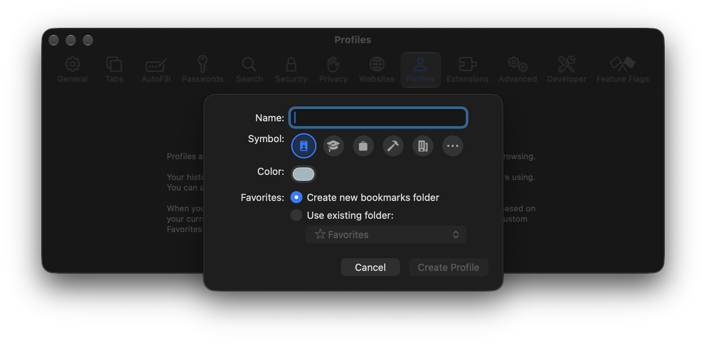

# Feat: New profiles can't use an existing bookmarks folder

Thx for Zephium, it's really amazing you're goated 🔥

Would it be a bad idea to let profile creation offer Safari's **Create new bookmarks folder** and **Use existing folder** choices?

**Current behavior:** The new profile dialog has no bookmarks folder setting.

**Requested:** Profiles in the same app data directory should share bookmarks when they use the same folder. Imports should skip URLs already in the matching folder while keeping intentional duplicates within a profile. History, cookies, and other website data should stay isolated.

