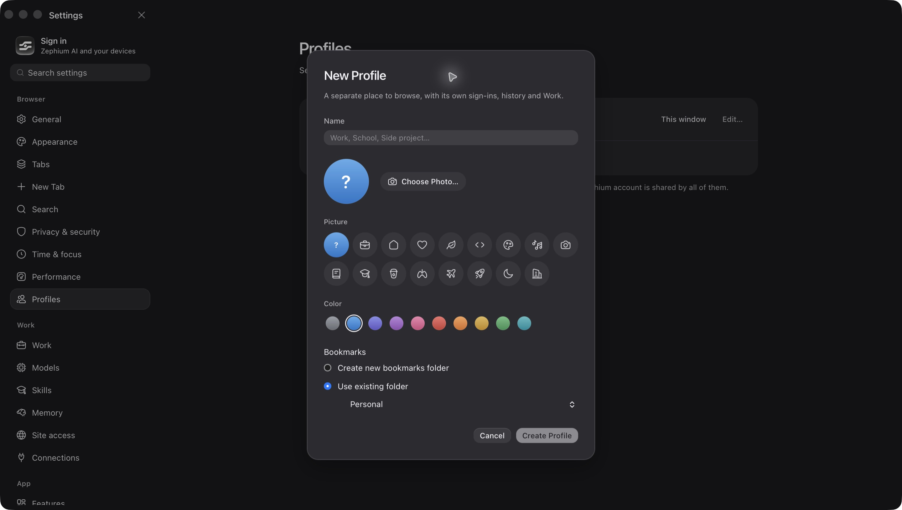

# Feat: Share bookmarks across profiles

## What changes for the user

When creating a profile, choose **Create new bookmarks folder** or **Use existing folder**. Profiles in the same app data directory that use the same folder share bookmarks. During import, URLs already in the matching folder are skipped, while intentional duplicates within one profile remain. History, cookies, and website data stay separate. 🤍

## How it was checked

- Store tests: `cargo test -p zephium-store --locked` (460 passed, 1 ignored).
- Frontend checks: `pnpm --dir frame run check` (typecheck, lint, styles, formatting, and 1,425 unit tests passed).
